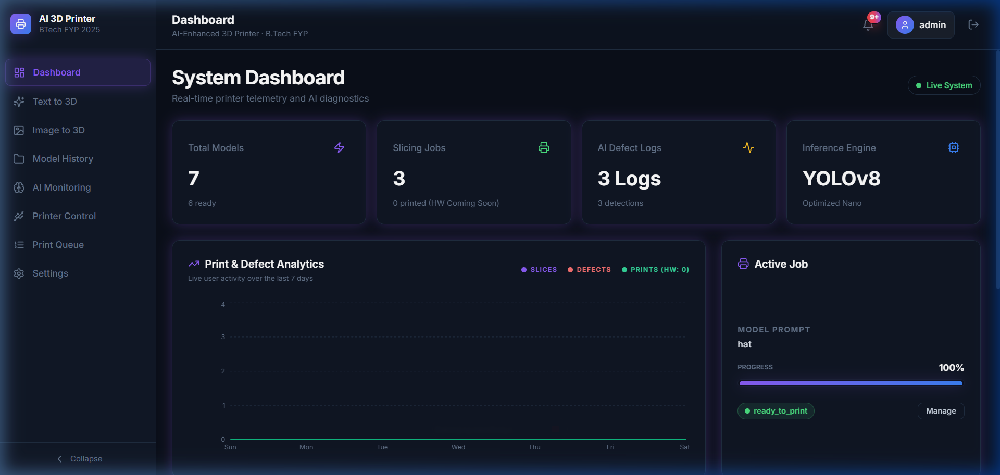
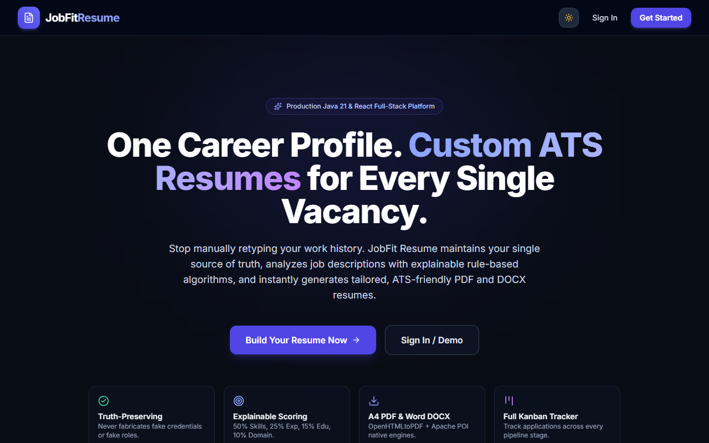

  

  <a href="https://github.com/Warcraft433">GitHub</a> ·
  <a href="https://adarsh-dev-io.vercel.app/">Portfolio</a> ·
  <a href="https://www.linkedin.com/in/adarsh-a-ab61b325a">LinkedIn</a> ·
  <a href="mailto:adarsh.official2011@gmail.com">Email</a>

<table>
<tr>
<td width="59%" valign="top">

## 🟠 About me

I'm an early-career developer and 2026 B.Tech graduate in Electronics and Communication Engineering. I focus on Java backend and full-stack development, and enjoy turning practical ideas into working software through hands-on projects. I'm currently building with Core Java, Spring Boot, REST APIs, databases, and frontend tools, and I'm open to software development opportunities.

📍 Bengaluru, India  ·  🎓 B.Tech ECE ('26)  ·  💼 Open to opportunities

## 🟠 Tech stack & tools

**Languages**  
    

**Backend**  
   

**Frontend**  
    

**Databases**  
  

**Tools**  
     

</td>
<td width="41%" valign="top">

## 🟠 GitHub statistics

  

  

## 🟠 Contribution activity

  

## 🟠 Top languages

  

<a href="https://github.com/Warcraft433">Recent activity ↗</a>

</td>
</tr>
</table>

## 🟠 Featured projects

<table>
<tr>
<td width="50%" valign="top">

### [PrintGuard AI ↗](https://github.com/Warcraft433/AI_3D_Printer)

AI-enhanced 3D printing project with a React interface, Spring Boot backend, and Python computer-vision service. Its README documents YOLOv8 defect detection, G-code slicing, and printer integrations.

`Java` `Spring Boot` `React` `Python` `YOLOv8`

</td>
<td width="50%" valign="top">

### [WorkSphere ↗](https://github.com/Warcraft433/WorkSphere)

Employment management system built with Java 21, Spring Boot 3, MySQL, and a vanilla HTML/CSS/JavaScript frontend. Its README describes employee, department, leave, payroll, and attendance modules, with JWT authentication and role-based access.

`Java` `Spring Boot` `MySQL` `JavaScript`

</td>
</tr>
<tr>
<td width="50%" valign="top">

### [JobFit Resume ↗](https://github.com/Warcraft433/JobFit-Resume)

Career platform for managing a career profile, comparing it with job descriptions, and generating tailored resume documents. The README describes a Spring Boot backend, React/TypeScript frontend, and PDF/DOCX export.

`Java` `Spring Boot` `React` `TypeScript`

</td>
<td width="50%" valign="top">

### [Number Utility System ↗](https://github.com/Warcraft433/NumberUtilitySystem)

Menu-driven Core Java console application with number checks, sequences, factorial, reverse, and calculator operations.

`Core Java` `Console app`

</td>
</tr>
</table>

<a href="https://github.com/Warcraft433?tab=repositories">View all repositories →</a>

---

<strong>LET'S CONNECT</strong>　·　<a href="https://github.com/Warcraft433">GitHub</a>　·　<a href="https://adarsh-dev-io.vercel.app/">Portfolio</a>　·　<a href="https://www.linkedin.com/in/adarsh-a-ab61b325a">LinkedIn</a>　·　<a href="mailto:adarsh.official2011@gmail.com">Email</a>

Midnight black · Electric orange · Bengaluru, India

